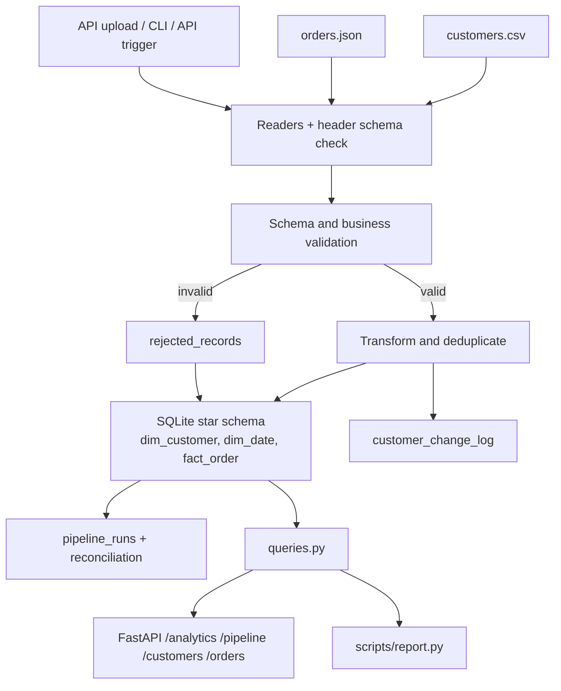

# Architecture

## Layers

| Layer | Module | Responsibility |
|---|---|---|
| Ingest | `readers.py` | Parse files, fail fast on unreadable/missing-column input |
| Validate | `validation.py` | Return reason codes per record; no DB writes |
| Transform | `transform.py` | Deterministic cleaning, money to paise |
| Load | `database.py`, `runner.py` | DDL, upserts, single transaction, run metrics |
| Serve | `queries.py`, `api/` | Read-only analytics and monitoring |

## User flow

1. **Producer** drops `customers.csv` + `orders.json` (or uploads them via `POST /pipeline/runs/upload`).
2. **Operator** triggers a run (CLI or `POST /pipeline/runs`) and gets back a `run_id` + summary.
3. Operator checks `GET /pipeline/runs/{run_id}` and `/reconciliation`; if there are rejects, inspects
   `/rejections` to see the exact source row and reason, fixes upstream data, reruns safely.
4. **Analyst** reads `/analytics/revenue/*` or runs `sql/analytics.sql`.

## Processing contract

- Missing required CSV columns or malformed JSON fail the whole run (recorded as `FAILED`).
- Customers are validated and upserted before order reference checks; changed attributes are logged.
- An order is accepted only when required fields, date (valid, not in future), amount (positive, ≤ 2 decimals) and customer reference are valid.
- Duplicate IDs within a batch are rejected (first occurrence wins).
- IDs already present in `fact_order` are skipped to preserve idempotency.
- All writes of a run happen in one transaction; a crash rolls back everything.
- Money is stored as integer paise, not floating-point rupees.
- Every run, including failures, is recorded in `pipeline_runs`.
